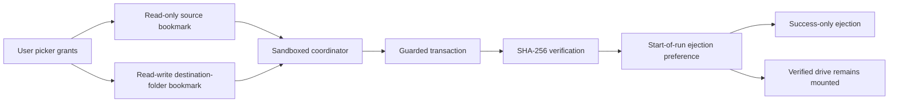

# Scoped Folder Mirror

Scoped Folder Mirror is a sandboxed macOS 14+ menu-bar app that mirrors one user-selected source folder to one dedicated folder on an external volume.

## Why This Exists

A background shell-based backup needed broad filesystem permission even though the operation only required access to one source folder and one destination folder. Scoped Folder Mirror replaces that broad process authority with a sandboxed app using two explicit user-selected grants.

Apple describes [App Sandbox](https://developer.apple.com/documentation/xcode/configuring-the-macos-app-sandbox) as kernel-enforced containment and [security-scoped bookmarks](https://developer.apple.com/documentation/professional-video-applications/enabling-security-scoped-bookmark-and-url-access?language=objc) as persistent access to user-selected locations.



## Security Model

- The sandbox can read only the selected source and can write only inside the selected destination folder.
- The destination must be a dedicated folder, not a volume root. Empty folders and existing destinations with a valid ownership marker are accepted.
- The app rejects internal, read-only, unavailable, mismatched, overlapping, and recursive destinations before writing.
- Unencrypted or unknown encryption status produces a persistent warning and requires explicit confirmation. Encryption is recommended, not enforced.
- A missing, unreadable, or temporarily unavailable source fails safely. Only an existing and readable empty folder can produce an empty mirror.
- Each run stages and hashes a complete next mirror, archives displaced files, swaps same-volume directories, and verifies the result.
- A versioned transaction marker distinguishes rollback state from disposal state. Interrupted runs recover to a complete previous or new mirror. Verified rollback data is renamed into `.cleanup/<run>` before deletion, so partially deleted cleanup data can never become authoritative.
- Abandoned staging and cleanup runs are removed only after the destination ownership marker and reserved paths have been validated. Untracked rollback or malformed control state stops recovery visibly.
- The app has no network, automation, Full Disk Access, helper, or shell entitlement.

## Installation

The first public builds are unsigned previews. Download the DMG for your Mac architecture from a GitHub pre-release marked `UNSIGNED PREVIEW`, drag the app to Applications, then use Finder's standard Open or System Settings' Open Anyway flow if macOS asks. Never disable Gatekeeper globally.

Stable releases are reserved for Developer ID signed, hardened, timestamped, notarized, and stapled artifacts.

## Usage

1. Choose one source folder.
2. Choose or create one dedicated folder on an external volume.
3. Confirm the warning if macOS does not report the volume as encrypted.
4. Keep the app open for automatic mirroring, or use Sync Now.
5. Use Launch at Login if desired. Pause affects automation only; manual sync remains available.
6. Leave **Eject destination after successful sync** enabled for the default cold-backup behavior, or disable it when the drive should remain mounted.

The ejection choice is captured when each run starts. Changing it during a run affects the next run, including an automatic follow-up. When enabled, ejection is attempted only after the current mirror, archive, and transaction state are verified. An ejection failure keeps the successful sync and reports a warning. When disabled, the app does not call the ejector and reports normal success.

Completed archive runs are never deleted automatically. Revoke either grant or reset all local app data from the menu.

## Limitations

- One source and one destination configuration.
- Automation runs only while the app is open.
- Keeping the destination mounted increases the time in which other processes, physical access, or accidental user actions can affect it.
- No telemetry, network service, updater, destination unlocking, or archive retention policy.
- Regular files, directories, and symlinks are supported. Other filesystem entry types fail visibly.
- Recovery logic has fault-injection coverage, but a backup is not verified until interruption and restore scenarios are tested with data you can safely replace.

## Build

Xcode 16 or later, XcodeGen 2.46 or later, and SwiftFormat are required.

```sh
make test
make lint
make build
make package-preview VERSION=0.1.0-preview.1 ARCH=arm64
```

`ARCH=x86_64` creates the Intel preview. Generated artifacts land in `dist/`.

## Verification

`make verify` runs tests, formatting checks, release-policy checks, and gitleaks when installed. Release automation additionally checks entitlements, architecture, code signing, DMG mounting, checksums, raw artifact strings, and the absence of coverage instrumentation.

Manual acceptance must use a disposable destination folder or APFS disk image. See [release verification](docs/release-verification.md).

## Privacy

No telemetry is collected. Bookmarks and the destination volume identifier remain in the sandbox container. Activity records contain only typed result codes, timestamps, counts, and byte totals. See [PRIVACY.md](PRIVACY.md).

## License

MIT. See [LICENSE](LICENSE).
